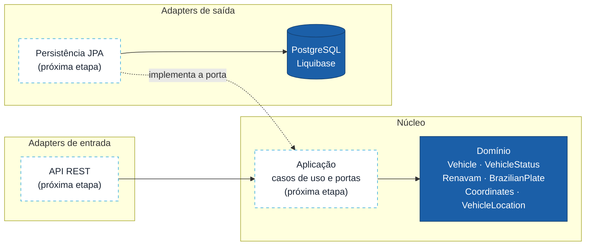

# GeoTrack API (Java)

Cadastro de veículos e rastreamento de posições GPS, com **Java 25**, **Spring Boot 4** e **arquitetura hexagonal**.

Este projeto reescreve em Java o [GeoTrack original](https://github.com/adrianovictor/geo-track-api), que desenvolvi em .NET Core + React como desafio técnico: uma API que recebe dados de rastreadores e mostra no mapa a rota percorrida por cada veículo. É um projeto de estudo e portfólio, construído em etapas. O objetivo é aplicar no ecossistema Java as mesmas práticas que uso no dia a dia com .NET.

> **Status:** em desenvolvimento. O domínio e o banco estão prontos; persistência e API REST são as próximas etapas ([roteiro](#roteiro)).

## Stack

| Camada | Tecnologias |
|---|---|
| Linguagem e framework | Java 25, Spring Boot 4.1 (threads virtuais habilitadas) |
| Banco de dados | PostgreSQL 17, Liquibase (migrações em SQL puro) |
| Testes | JUnit 5, AssertJ, ArchUnit, Testcontainers |
| Qualidade | JaCoCo (cobertura), Spotless com Palantir Java Format |
| Front-end | Angular 21, em repositório próprio: [geo-track-frontend](https://github.com/adrianovictor/geo-track-frontend) |

## Arquitetura

O domínio fica no centro e não conhece nenhum framework. Tudo que é tecnologia (HTTP, banco, arquivos) entra por **adapters** que implementam **portas** definidas pela aplicação.



Em azul, o que já está implementado; tracejado, as próximas etapas.

**A regra não depende de disciplina.** O [`ArchitectureTest`](src/test/java/br/com/geotrack/ArchitectureTest.java) usa ArchUnit para garantir, a cada build, que nenhuma classe de `domain` dependa de algo fora do próprio domínio e da biblioteca padrão do Java. Uma anotação do Spring ou do JPA no domínio faz o build falhar.

## Destaques do domínio

- **Entidade rica.** `Vehicle` tem construtor privado e dois métodos de fábrica com intenções diferentes: `register` cria um veículo novo, aplicando as regras; `restore` reconstrói um veículo que já existe no banco. Não há setters: o estado muda por métodos com nome de negócio (`update`, `activate`, `block`, `delete`).
- **Regras de status no próprio enum.** `VehicleStatus.transitionTo` decide se uma mudança é permitida. Um veículo excluído é estado final, e qualquer tentativa de alterá-lo lança `InvalidStatusTransitionException`.
- **Value Objects como `record`s.** Se o objeto existe, ele é válido:
  - `Renavam`: 9 a 11 dígitos, completado com zeros à esquerda, com **dígito verificador** conferido.
  - `BrazilianPlate`: aceita os padrões antigo (`ABC1234`) e Mercosul (`ABC1D23`).
  - `Coordinates`: latitude entre ±90 e longitude entre ±180, normalizadas para 6 casas decimais (cerca de 10 cm).
- **Erros de domínio com o campo.** `DomainValidationException` informa qual campo falhou, para a API responder com o erro no lugar certo.

## Banco de dados

As migrações ficam em [`src/main/resources/db/changelog`](src/main/resources/db/changelog), em SQL puro (formato *Liquibase formatted SQL*), versionadas por release (`1.0.0/`). Algumas decisões da primeira migração:

- **Exclusão lógica com recadastro.** RENAVAM e placa são únicos só entre veículos não excluídos (índices únicos parciais com `where status <> 4`). Um veículo excluído pode ser cadastrado de novo.
- **Concorrência otimista.** A coluna `version` permite detectar duas edições simultâneas do mesmo veículo.
- **Sequência com `increment by 50`**, alinhada ao otimizador do Hibernate: uma ida ao banco reserva 50 ids.
- **Datas com fuso** (`timestamptz`) e um `unique_id` (UUID) para expor o veículo sem revelar o id sequencial.
- **Rollback** declarado em cada *changeset*.

O schema é responsabilidade do Liquibase. O Hibernate só valida (`ddl-auto: validate`).

## Estrutura

```
src/main/java/br/com/geotrack
└── domain
    ├── vehicle    Vehicle, VehicleStatus, Renavam, BrazilianPlate e as exceções do veículo
    ├── location   Coordinates, VehicleLocation
    ├── user       User, Role
    └── shared     DomainException, DomainValidationException, Guard

src/main/resources/db/changelog
├── db.changelog-master.yaml
└── 1.0.0/001-create-vehicles.sql
```

## Como rodar

**Pré-requisitos:** JDK 25 (o Maven vem junto, no `mvnw`). Docker, só para subir a aplicação.

```bash
# testes, checagem de formatação e relatório de cobertura
./mvnw verify

# corrige a formatação, se o verify reclamar
./mvnw spotless:apply
```

São 58 testes de domínio, rodando em poucos segundos, sem banco nem container. O relatório de cobertura fica em `target/site/jacoco/index.html`.

Para subir a aplicação com um PostgreSQL descartável (precisa do Docker):

```bash
./mvnw spring-boot:test-run
```

O Testcontainers cria o banco, o Liquibase aplica as migrações e a aplicação responde em `http://localhost:8080/actuator/health`. Os endpoints de negócio chegam na etapa de API REST.

## Roteiro

- [x] Estrutura do projeto, Spotless, JaCoCo e ArchUnit
- [x] Domínio: veículo, status, RENAVAM, placa, coordenadas e localização
- [x] Primeira migração do banco com Liquibase
- [ ] Casos de uso e portas da aplicação
- [ ] Persistência com JPA e testes de integração com Testcontainers
- [ ] API REST com Problem Details (RFC 9457) e documentação OpenAPI
- [ ] Importação de posições GPS por arquivo
- [ ] Autenticação com JWT
- [ ] Pipeline de CI no GitHub Actions e imagem Docker

## Autor

**Adriano Victor dos Santos**, Engenheiro de Software Sênior .NET e Tech Lead.
[LinkedIn](https://www.linkedin.com/in/adrianovictorsantos/) · [GitHub](https://github.com/adrianovictor)
